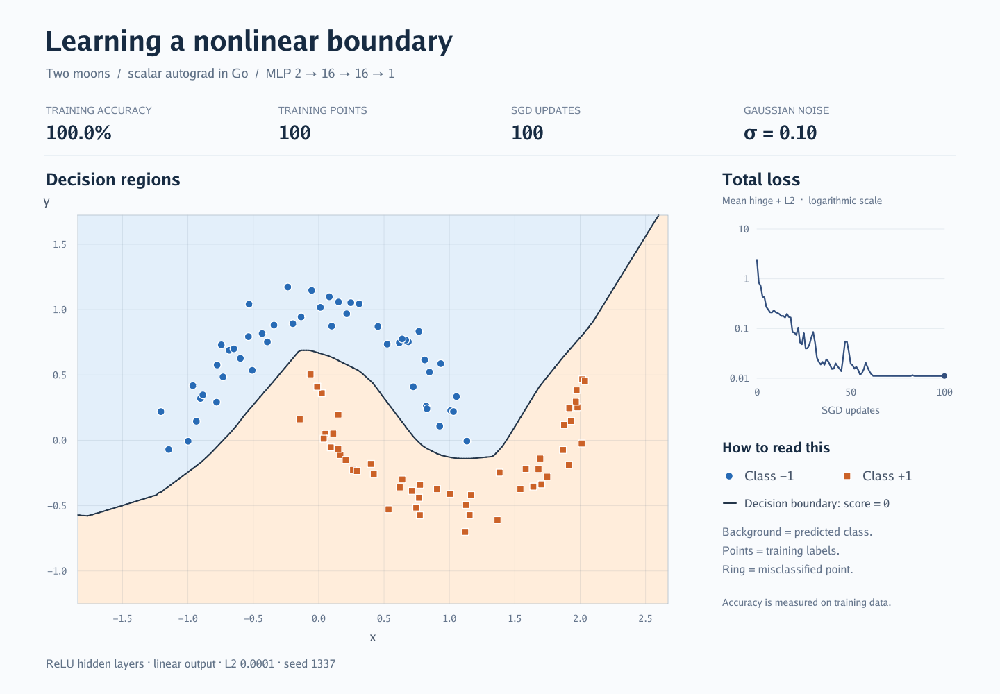
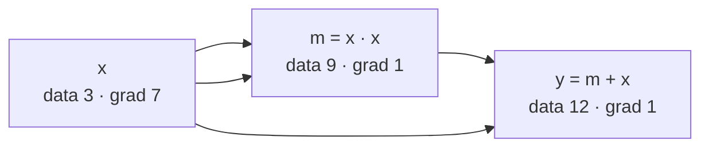

# micrograd-go

[](https://github.com/dimchansky/micrograd-go/actions/workflows/test.yml)
[](https://pkg.go.dev/github.com/dimchansky/micrograd-go)

A tiny scalar autograd engine and neural-network library in Go, written to be
read from top to bottom. The engine is about 100 lines of code; the network
on top of it is about 100 more. Together they are enough to train a
multi-layer perceptron that learns a nonlinear decision boundary:



The rule for everything in this repository: each piece of code must be needed
to explain **derivatives**, the **computation graph**, or a **training step**.
There are no tensors, no optimizers, no layers beyond the perceptron, and no
dependencies in the library itself.

- [Quick start](#quick-start)
- [What to read, in which order](#what-to-read-in-which-order)
- [1. A value that remembers where it came from](#1-a-value-that-remembers-where-it-came-from)
- [2. Local derivatives](#2-local-derivatives)
- [3. The chain rule, and why gradients use `+=`](#3-the-chain-rule-and-why-gradients-use-)
- [4. Backward: visiting nodes in the right order](#4-backward-visiting-nodes-in-the-right-order)
- [5. Neuron, Layer, MLP](#5-neuron-layer-mlp)
- [6. Training: forward, backward, update](#6-training-forward-backward-update)
- [7. Losses used in the examples](#7-losses-used-in-the-examples)
- [8. Accumulating gradients over mini-batches](#8-accumulating-gradients-over-mini-batches)
- [Rules of use](#rules-of-use)
- [How correctness is tested](#how-correctness-is-tested)
- [Design choices and limits](#design-choices-and-limits)
- [Coming from the Python micrograd](#coming-from-the-python-micrograd)

## Quick start

Requires Go 1.22 or newer.

```sh
go test ./...        # check the engine and the network
go run ./cmd/demo    # one derivative, then fit y = 2x + 1
go run ./cmd/mlp     # learn XOR with a 2 → 8 → 1 network
go run ./cmd/moons   # learn the two-moons boundary and draw moons.png
```

Use it as a library:

```sh
go get github.com/dimchansky/micrograd-go
```

```go
import mg "github.com/dimchansky/micrograd-go"

x := mg.New(3)
y := x.Mul(x).Add(x) // y = x² + x
y.Backward()
fmt.Println(y.Data, x.Grad) // 12 7, because dy/dx = 2x + 1 = 7
```

## What to read, in which order

| File | What it teaches |
| --- | --- |
| [engine.go](engine.go) | `Value`, the four primitive operations and `Backward` |
| [cmd/demo/main.go](cmd/demo/main.go) | A single derivative, then a full training loop for `y = w·x + b` |
| [nn.go](nn.go) | `Neuron`, `Layer`, `MLP` built only from `Value` operations |
| [cmd/mlp/main.go](cmd/mlp/main.go) | Training a network on XOR, a problem a single neuron cannot solve |
| [cmd/moons/main.go](cmd/moons/main.go) | Classification with hinge loss, L2 regularization and mini-batches |
| [engine_test.go](engine_test.go), [nn_test.go](nn_test.go) | How the gradients are checked independently |

[cmd/moons/plot.go](cmd/moons/plot.go) only draws the picture. You do not need
it to understand training.

## 1. A value that remembers where it came from

A neural network is a large formula. Training needs, for every weight $w$,
the derivative $\partial L / \partial w$ of the loss $L$ with respect to that
weight: it says how $L$ changes when $w$ is nudged. Writing those derivatives
by hand is impractical. Instead, while the formula is being *computed*, we
record *how* it was computed, and then let the program differentiate it.

That record is the computation graph, and each node in it is a `Value`:

```go
type Value struct {
    Data     float64   // result of the forward computation
    Grad     float64   // ∂(final result)/∂(this node), filled by Backward
    prev     []*Value  // operands this node was computed from
    backward func()    // passes Grad on to the operands (the local chain rule)
}
```

Each field has exactly one job:

| Field | Why it is needed |
| --- | --- |
| `Data` | The number itself. Local derivatives depend on it (for $a \cdot b$ the derivative with respect to $a$ is the value of $b$). |
| `Grad` | Where the answer is stored. After `Backward`, `w.Grad` is $\partial L/\partial w$. |
| `prev` | Lets `Backward` find every node the result depends on. |
| `backward` | Knows the derivative rule of the operation that produced this node. |

`New(3)` makes a *leaf*: no operands, no `backward`. Inputs, targets,
constants and weights are all leaves. Every operation such as `x.Mul(x)`
returns a new node that points to its operands. For `y = x·x + x`:



Arrows show the forward computation. `Backward` walks them in the opposite
direction.

## 2. Local derivatives

Each operation only has to know its own, *local* derivative: how its output
changes when one of its operands changes. These are the rules from any
calculus textbook:

| Operation | Forward | Local derivatives |
| --- | --- | --- |
| `a.Add(b)` | $o = a + b$ | $\dfrac{\partial o}{\partial a} = 1,\quad \dfrac{\partial o}{\partial b} = 1$ |
| `a.Mul(b)` | $o = a \cdot b$ | $\dfrac{\partial o}{\partial a} = b,\quad \dfrac{\partial o}{\partial b} = a$ |
| `a.Pow(n)` | $o = a^n$ | $\dfrac{\partial o}{\partial a} = n \cdot a^{n-1}$ |
| `a.ReLU()` | $o = \max(0, a)$ | $\dfrac{\partial o}{\partial a} = 1$ if $a > 0$, otherwise $0$ |

`Neg`, `Sub` and `Div` need no rules of their own. They are built from the
four operations above, and the chain rule combines the existing rules:

```math
-a = a \cdot (-1), \qquad a - b = a + (-b), \qquad \frac{a}{b} = a \cdot b^{-1}.
```

The exponent of `Pow` is a plain `float64`, not a `Value`: it is a constant,
so no gradient needs to flow into it. Two edge cases are fixed on purpose.
ReLU has no derivative at exactly $0$, so $0$ is used there. And
$\frac{d}{da} a^0 = 0$ everywhere, including at $a = 0$, where the general
formula would compute $0 \cdot 0^{-1} = 0 \cdot \infty = \text{NaN}$.

## 3. The chain rule, and why gradients use `+=`

Let $L$ be the final result and $o = a \cdot b$ some node inside the graph.
Once we know $\partial L / \partial o$ (stored in `o.Grad`), the chain rule
gives the derivatives for the operands:

```math
\frac{\partial L}{\partial a} = \frac{\partial L}{\partial o} \cdot \frac{\partial o}{\partial a} = \texttt{o.Grad} \cdot b,
\qquad
\frac{\partial L}{\partial b} = \texttt{o.Grad} \cdot a.
```

This is literally the closure that `Mul` stores next to the forward result:

```go
out := &Value{Data: v.Data * other.Data, prev: []*Value{v, other}}
out.backward = func() {
    v.Grad += other.Data * out.Grad
    other.Grad += v.Data * out.Grad
}
```

The closure captures pointers to `v`, `other` and `out`. It runs later, during
`Backward`, when `out.Grad` is known.

Why `+=` and not `=`? Because a node can influence the result through
several paths, and the multivariable chain rule says to **sum** the
contributions of all paths:

```math
\frac{\partial L}{\partial x} = \sum_{\text{nodes } o \text{ that use } x} \frac{\partial L}{\partial o}\cdot\frac{\partial o}{\partial x}.
```

In the graph above, `x` reaches `y` three times: twice through `m = x·x` and
once directly. The three contributions are $3 + 3 + 1 = 7$, which is exactly
$\frac{d}{dx}(x^2 + x) = 2x + 1$ at $x = 3$. With `=`, each contribution would
overwrite the previous one and the answer would be wrong.

## 4. Backward: visiting nodes in the right order

`backward` of a node uses that node's `Grad`, so it may run only after the
`Grad` is **complete**, that is, after every node that uses it has already
contributed. Consider a shared intermediate $u$:

```math
u = x^2, \qquad y = u^2 + u.
```

At $x = 2$: $u = 4$, and $u$ receives two contributions, $2u = 8$ from $u^2$
and $1$ from $+u$. Only when `u.Grad` $= 9$ is final may $u$ pass it on to
$x$, giving $9 \cdot 2x = 36$. If $u$ passed on its partial gradient early and
then again later, the first part would be counted twice.

The order that guarantees this is a **topological order**: a list in which
every node comes after all of its operands. Walking it from the end visits
every consumer before what it consumes. `Backward` builds it with a
depth-first search and then walks it backwards:

```go
func (v *Value) Backward() {
    var order []*Value
    seen := make(map[*Value]bool)
    var visit func(*Value)
    visit = func(n *Value) {
        if seen[n] {
            return // a shared node is listed once
        }
        seen[n] = true
        for _, operand := range n.prev {
            visit(operand)
        }
        order = append(order, n) // only after all its operands
    }
    visit(v)

    v.Grad = 1 // dv/dv = 1: the chain starts here
    for i := len(order) - 1; i >= 0; i-- {
        if order[i].backward != nil {
            order[i].backward()
        }
    }
}
```

Every node's `backward` runs exactly once, so the cost of the backward pass
is proportional to the size of the graph, roughly the same as the forward
pass. This is what makes reverse-mode differentiation (backpropagation)
practical: one backward pass gives the derivative of the loss with respect to
**all** weights at once.

## 5. Neuron, Layer, MLP

A **neuron** with weights $w_1 \dots w_n$ and bias $b$ computes

```math
\text{neuron}(x) = \mathrm{ReLU}\!\left(\sum_{i=1}^{n} w_i x_i + b\right)
```

or the same sum without ReLU for a linear neuron. In code it is just a loop
of `Mul` and `Add`, so its gradient comes for free from section 2. Weights and
bias are ordinary leaf `Value`s. Nothing marks them as trainable: they are
parameters only because the training loop reads their `Grad` and changes
their `Data`.

A **layer** is several independent neurons reading the same inputs. An
**MLP** (multi-layer perceptron) feeds each layer's outputs into the next one.
`NewMLP(2, []int{16, 16, 1}, rng)` builds $2 \to 16 \to 16 \to 1$.

Three decisions in [nn.go](nn.go) deserve an explanation:

- **ReLU between layers.** A composition of linear functions is still
  linear: $W_2(W_1 x) = (W_2 W_1)x$. Without a nonlinearity, any number of
  layers could only draw a straight decision boundary.
- **Linear last layer.** The output can then be any real number: a
  regression value or an unbounded classification score.
- **Random initial weights in $[-1, 1)$, zero biases.** If all weights
  started equal, every neuron in a layer would compute the same thing,
  receive the same gradient and stay identical forever. Random weights break
  that symmetry. The random generator is passed in explicitly, so a run is
  reproducible from its seed.

`Parameters()` returns pointers to the network's own weight leaves, ordered
layer → neuron → weights → bias.

## 6. Training: forward, backward, update

Training searches for weights that make a loss $L$ small. The gradient
$\partial L / \partial p$ points in the direction in which $L$ grows fastest,
so a small step against it decreases $L$. This is **gradient descent**, with a
learning rate $\eta$ that sets the step size:

```math
p \leftarrow p - \eta \, \frac{\partial L}{\partial p}\qquad\text{for every parameter } p.
```

Every step has the same three phases (see [cmd/demo/main.go](cmd/demo/main.go)):

```go
params := model.Parameters()
for step := 0; step < steps; step++ {
    // 1. Forward: build a fresh graph of the loss from the current weights.
    loss := computeLoss(model)

    // 2. Backward: clear last step's gradients, then compute new ones.
    for _, p := range params {
        p.Grad = 0
    }
    loss.Backward()

    // 3. Update: plain arithmetic on Data, not part of any graph.
    for _, p := range params {
        p.Data -= learningRate * p.Grad
    }
}
```

`computeLoss` stands for your own code that builds the loss.

- **Why zero the gradients?** `Backward` adds to `Grad` (section 3). Without
  resetting, the gradient of the previous step would leak into this one.
- **Why a fresh graph every step?** The operation nodes hold the `Data` that
  was current when they were built. The weight leaves are the same pointers
  from step to step, but each forward pass creates new nodes from their new
  values. The update itself is ordinary arithmetic, so the graphs of
  consecutive steps are never connected.

## 7. Losses used in the examples

**Mean squared error** ([cmd/demo](cmd/demo/main.go), [cmd/mlp](cmd/mlp/main.go)),
for predictions $\hat y_i$ and targets $y_i$:

```math
L = \frac{1}{N}\sum_{i=1}^{N}(\hat y_i - y_i)^2, \qquad \frac{\partial L}{\partial \hat y_i} = \frac{2}{N}(\hat y_i - y_i).
```

It is built from `Sub`, `Pow(2)`, `Add` and `Div`, so `Backward` derives the
gradient above by itself.

**Hinge loss with L2 regularization** ([cmd/moons](cmd/moons/main.go)), for
labels $y_i \in \lbrace -1, +1 \rbrace$ and network scores $s_i$:

```math
L = \underbrace{\frac{1}{N}\sum_{i=1}^{N} \max(0,\ 1 - y_i s_i)}_{\text{hinge}} \;+\; \underbrace{\alpha \sum_{p} p^2}_{\text{L2}}.
```

The product $y_i s_i$ is positive when the sign of the score is right. A
point stops contributing once that margin reaches 1, so confidently correct
points no longer move the weights, and wrong points are penalized linearly.
The L2 term adds $2\alpha p$ to each gradient, which pulls every weight
slightly towards zero and keeps the boundary smooth. The predicted class is
the sign of $s_i$. The moons example trains for 100 steps with a learning rate
that decays linearly from $1.0$ to $0.1$: large steps first, small ones to
settle.

## 8. Accumulating gradients over mini-batches

Because `Grad` accumulates, the gradient of a large data set can be computed
in pieces without any changes to the engine. Split $N$ samples into
mini-batches $B$ of size $n_B$. Each mini-batch builds its own fresh graph of
its mean loss $L_B$ (including the same regularization term); scaling it by
$n_B / N$ before `Backward` makes the sum of the pieces equal the full loss,
because the weights $n_B/N$ add up to 1:

```math
\sum_{B} \frac{n_B}{N} \left( \frac{1}{n_B}\sum_{i \in B} \ell_i + \alpha R \right)
= \frac{1}{N}\sum_{i=1}^{N} \ell_i + \alpha R.
```

```go
for _, p := range params {
    p.Grad = 0 // once for the whole data set
}
for _, batch := range batches {
    loss := meanLoss(model, batch) // a fresh graph per mini-batch
    weight := float64(len(batch)) / float64(totalSamples)
    loss.Mul(mg.New(weight)).Backward()
}
for _, p := range params {
    p.Data -= learningRate * p.Grad // one update after all pieces
}
```

The weight also handles a smaller last mini-batch correctly. Try it with
`go run ./cmd/moons -batch 10`: the result matches the full-batch run, which
[cmd/moons/main_test.go](cmd/moons/main_test.go) checks.

## Rules of use

The engine is deliberately small, so it does not detect misuse. The training
loops above follow these rules automatically:

1. **Build a new graph for every `Backward`.** Intermediate nodes keep their
   `Grad`, so a second `Backward` on the same graph adds everything twice.
2. **Zero the weights' `Grad`** before each update (or once before a group of
   mini-batches).
3. **Change weights' `Data` only after `Backward`.** The backward closures
   read their operands' `Data`; changing it in between gives wrong gradients.
4. **Use `*Value`, never copy a `Value`,** and do not run `Backward`
   concurrently on graphs that share nodes.

## How correctness is tested

The tests never compare autograd with itself:

- **Hand-derived formulas.** Small graphs with repeated operands and shared
  intermediate nodes are checked against derivatives worked out on paper.
  Two deliberately tangled graphs that use every operation are simplified by
  hand into polynomials.
- **Finite differences.** For a function $f$ written in plain `float64`
  arithmetic, the derivative is approximated by the central difference
  $f'(x) \approx \dfrac{f(x+h) - f(x-h)}{2h}$ and compared with the autograd result. The same check covers every weight
  and input of an MLP.
- **Behaviour.** Networks learn XOR and the two moons; mini-batch training
  gives the same weights as full-batch training; shape mistakes panic.

```sh
go test ./...
go test -race ./...
go vet ./...
go test -run '^$' -bench . -benchmem .   # cost of scalar autograd
```

## Design choices and limits

- **Methods instead of operators.** Go has no operator overloading, so
  `a*b + c` is written `a.Mul(b).Add(c)`.
- **Always slices.** `Layer.Forward` and `MLP.Forward` return `[]*Value`
  even for one output, so the types never change with the layer width.
- **Panics for shape errors.** A wrong number of inputs is a programming
  mistake, not a runtime condition, so it panics instead of returning an
  error.
- **Scalar nodes.** Every single multiplication is a heap-allocated node with
  a closure. That makes every step visible and slow: the moons network
  builds tens of thousands of nodes per step. Real frameworks apply the same
  ideas to whole arrays (tensors) at once and run them on GPUs.
- **First derivatives only.** There is no differentiation of the backward
  pass itself.

## Coming from the Python micrograd

This is a Go port of the design of Andrej Karpathy's
[micrograd](https://github.com/karpathy/micrograd), presented in the lecture
[The spelled-out intro to neural networks and backpropagation](https://www.youtube.com/watch?v=VMj-3S1tku0).
If you follow the lecture, the names map as follows:

| Python | Go |
| --- | --- |
| `Value(3.0)` | `mg.New(3)` |
| `a + b`, `a * b`, `a ** 2`, `a.relu()` | `a.Add(b)`, `a.Mul(b)`, `a.Pow(2)`, `a.ReLU()` |
| `-a`, `a - b`, `a / b` | `a.Neg()`, `a.Sub(b)`, `a.Div(b)` |
| `.data`, `.grad` | `.Data`, `.Grad` |
| `_prev`, `_backward` | `prev`, `backward` |
| `_op` (only for drawing graphs) | not needed |
| `model.zero_grad()` | `for _, p := range params { p.Grad = 0 }` |
| `MLP(2, [16, 16, 1])` | `mg.NewMLP(2, []int{16, 16, 1}, rng)` |
| `model(x)` returns a scalar for one output | `model.Forward(x)` always returns a slice |

Differences in behaviour: the derivative of $a^0$ is defined as 0 (the Python
version gives NaN at $a = 0$), random numbers come from an explicit
`*rand.Rand`, and the two-moons data is generated in Go, so the points differ
from scikit-learn's for the same seed.

## License

[MIT](LICENSE). The original micrograd is also MIT-licensed; its copyright
notice is kept in the LICENSE file.
