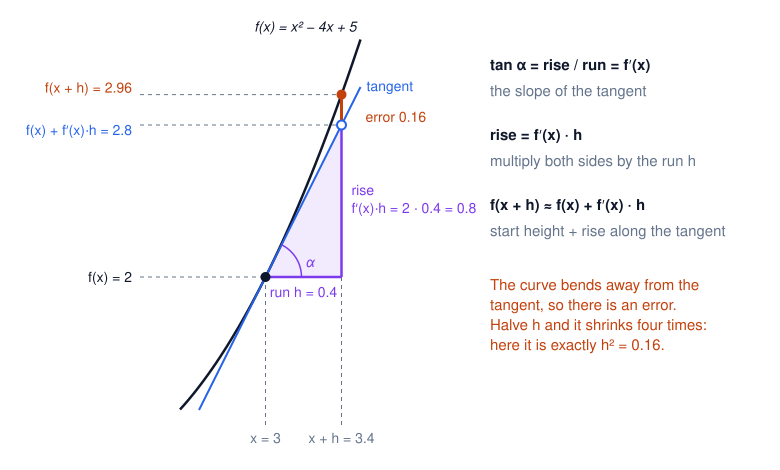
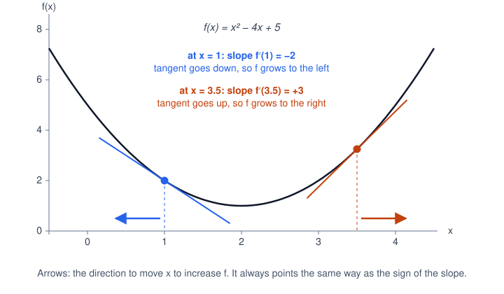
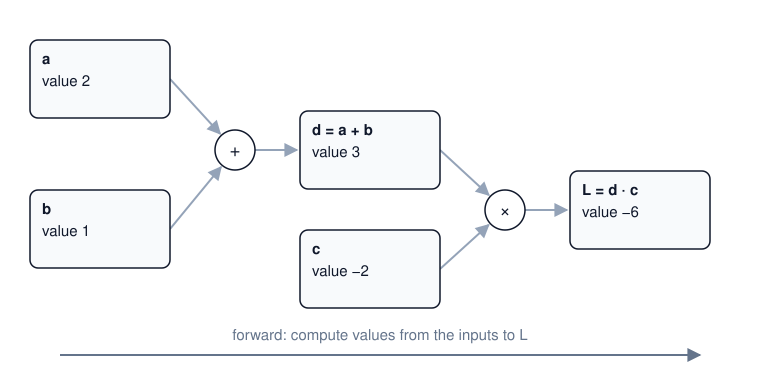
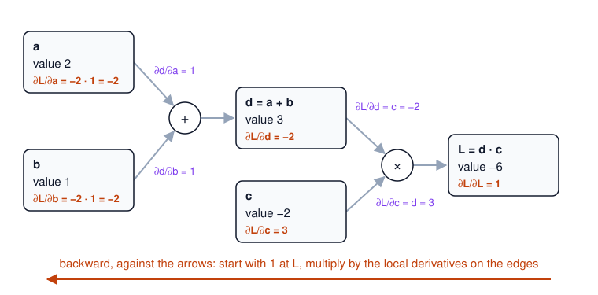

# From a derivative to backpropagation

This is the idea behind the whole library, built up from school calculus one
step at a time. If you know what a derivative is but have never seen why it
is so useful for training neural networks, read this first; the code in
[engine.go](../engine.go) will then read like a summary of it.

1. [The derivative is a slope](#1-the-derivative-is-a-slope)
2. [The slope tells you which way to move](#2-the-slope-tells-you-which-way-to-move)
3. [Several inputs: one derivative for each](#3-several-inputs-one-derivative-for-each)
4. [A function as a graph of small operations](#4-a-function-as-a-graph-of-small-operations)
5. [The question: how sensitive is L to each node?](#5-the-question-how-sensitive-is-l-to-each-node)
6. [The last operation: local derivatives](#6-the-last-operation-local-derivatives)
7. [One step further back: the chain rule](#7-one-step-further-back-the-chain-rule)
8. [The whole procedure](#8-the-whole-procedure)
9. [Using the gradient](#9-using-the-gradient)
10. [What comes next](#10-what-comes-next)

## 1. The derivative is a slope

Take a function $f(x)$ and a point $x$. Move the input a little, by $h$, and
see how much the output changed per unit of input change:

```math
\dfrac{f(x+h) - f(x)}{h}
```

This is the slope of the straight line through the points $(x, f(x))$ and
$(x+h, f(x+h))$. As $h$ shrinks towards zero, this line turns into the
**tangent** at $x$, and its slope becomes the **derivative**:

```math
f'(x) = \dfrac{df}{dx} = \lim_{h \to 0} \dfrac{f(x+h) - f(x)}{h}.
```

Example: $f(x) = x^2 - 4x + 5$, whose derivative is $f'(x) = 2x - 4$. At
$x = 1$ we have $f(1) = 2$ and $f'(1) = 2 \cdot 1 - 4 = -2$. The same number
appears if you simply compute the ratio for smaller and smaller $h$:

| $h$ | $f(1+h)$ | $\dfrac{f(1+h) - f(1)}{h}$ |
| --- | --- | --- |
| 0.1 | 1.81 | −1.9 |
| 0.01 | 1.9801 | −1.99 |
| 0.001 | 1.998001 | −1.999 |

Nudging the input, measuring the output and dividing gets as close to the
derivative as you like; the rule $f'(x) = 2x - 4$ gives the exact value.

### The derivative as a triangle

The slope of a straight line is *rise over run*: how far the line goes up
for a given distance to the right. Draw a right triangle under the line,
with a horizontal side (the run) and a vertical side (the rise). The ratio
of the two is the tangent of the angle $\alpha$ between the line and the
horizontal:

```math
\tan \alpha = \dfrac{\text{rise}}{\text{run}}.
```

For the tangent line at $x$, this ratio is the derivative:
$\tan \alpha = f'(x)$. The picture zooms in on the same function at $x = 3$,
where $f(3) = 2$ and $f'(3) = 2 \cdot 3 - 4 = 2$. Both axes use the same
scale, so the drawn angle really has $\tan \alpha = 2$.



Step to the right by $h = 0.4$. This step is the run of the triangle, so
from now on we write $h$ for the run.

1. The rise divided by the run is the slope: $\text{rise} / \text{run} = f'(x)$.
2. Multiply both sides by the run:
   $\text{rise} = f'(x) \cdot \text{run} = f'(x) \cdot h = 2 \cdot 0.4 = 0.8$.
3. The tangent starts at height $f(x) = 2$ and climbs by the rise, so at
   $x + h$ it is at $f(x) + \text{rise} = f(x) + f'(x) \cdot h = 2.8$.
4. The curve itself is at $f(3.4) = 2.96$. The gap between the curve and the
   tangent is the **error**: $2.96 - 2.8 = 0.16$.

So the **change** of the curve, $f(x+h) - f(x) = 2.96 - 2 = 0.96$, splits into
the rise along the tangent and the error:

```math
\underbrace{f(x+h) - f(x)}_{\text{change}\ =\ 0.96} = \underbrace{f'(x) \cdot h}_{\text{rise}\ =\ 0.8} + \underbrace{\text{error}}_{0.16}.
```

The error shrinks much faster than the step: here it is exactly $h^2$. With
a ten times smaller step, $h = 0.04$, the rise is $0.08$ but the error only
$0.0016$, a hundred times smaller. So for a small step we can drop the error,
and the change is about the rise:

```math
f(x+h) - f(x) \approx f'(x) \cdot h, \qquad\text{or equivalently}\qquad f(x+h) \approx f(x) + f'(x) \cdot h.
```

In words: the output changes by about **the slope times the step**.

## 2. The slope tells you which way to move

The rule *change ≈ slope × step*, $f(x+h) - f(x) \approx f'(x) \cdot h$, holds
at every point and for a step in either direction: $h$ may be negative, a
step to the left. Read it in the two cases of the next picture. It shows two
points of the same function: $x = 1$ from the table in section 1, and $x = 3.5$, where
$f(3.5) = 3.25$ and $f'(3.5) = 2 \cdot 3.5 - 4 = 3$.



- At $x = 1$ the slope is $-2$. A step to the right ($h > 0$) makes
  $f'(x) \cdot h$ negative: $f$ goes **down**. A step to the left makes $f$
  go **up**.
- At $x = 3.5$ the slope is $+3$. A step to the right makes $f$ go **up**; a
  step to the left makes it go **down**.

In both cases, moving $x$ in the direction of the sign of $f'(x)$ increases
$f$, and moving against it decreases $f$.

Instead of looking at the sign and choosing a direction by hand, we can build
the step out of the slope itself:

```math
h = \eta \cdot f'(x),
```

where $\eta$ (the Greek letter *eta*) is a small positive number such as
$0.1$, the **step size**. Because $\eta$ is positive, $h$ always has the same
sign as the slope: at $x = 1$ the slope $-2$ gives $h = 0.1 \cdot (-2) = -0.2$,
a step to the left; at $x = 3.5$ the slope $+3$ gives $h = +0.3$, a step to
the right. These are exactly the directions in which $f$ grows.

How much does $f$ change after such a step? Take the approximation from the
end of section 1, *change ≈ slope × step*, and put our step in place
of $h$:

```math
\begin{aligned}
f(x+h) - f(x) &\approx f'(x) \cdot h && \text{change} \approx \text{slope} \times \text{step} \\
&= f'(x) \cdot \eta \cdot f'(x) && \text{substitute } h = \eta \cdot f'(x) \\
&= \eta \cdot \left(f'(x)\right)^2 && \text{the slope appears twice}
\end{aligned}
```

The slope is multiplied by itself, and a number squared is never negative:
$(-2) \cdot (-2) = 4$ and $3 \cdot 3 = 9$. In words: when the slope is negative,
the step is negative too, and negative × negative is positive. With $\eta > 0$
the change is therefore positive whichever way the tangent tilts, so $f$
increases.

Stepping the other way, $h = -\eta \cdot f'(x)$, gives a change of about
$-\eta \cdot (f'(x))^2$, which is negative, so $f$ decreases. Both together:

```math
x_{\text{new}} = x + \eta \cdot f'(x) \quad\text{increases } f,
\qquad
x_{\text{new}} = x - \eta \cdot f'(x) \quad\text{decreases } f.
```

(Where the slope is exactly 0, here at the bottom of the parabola at $x = 2$,
the step is zero and $x$ stays put.)

Check with $\eta = 0.1$, predicted change against the real one:

| Start | Slope | Step $h$ | Predicted change, slope × $h$ | New $x$ | New $f$ | Actual change |
| --- | --- | --- | --- | --- | --- | --- |
| $x = 1$, $f = 2$ | −2 | $+0.1 \cdot (-2) = -0.2$ | +0.4 | 0.8 | 2.44 | +0.44 ↑ |
| $x = 1$, $f = 2$ | −2 | $-0.1 \cdot (-2) = +0.2$ | −0.4 | 1.2 | 1.64 | −0.36 ↓ |
| $x = 3.5$, $f = 3.25$ | +3 | $+0.1 \cdot 3 = +0.3$ | +0.9 | 3.8 | 4.24 | +0.99 ↑ |
| $x = 3.5$, $f = 3.25$ | +3 | $-0.1 \cdot 3 = -0.3$ | −0.9 | 3.2 | 2.44 | −0.81 ↓ |

The prediction is not exact, because the tangent only approximates the
curve; the smaller the step, the closer they agree. But the direction is
right in every row, and that is what matters.

Two things to keep:

- **We did not need to see the whole curve.** One number at the current
  point, the slope, was enough to know which way to go. That is what makes
  training possible: a neural network's loss is a function of thousands of
  numbers, and nobody can draw it.
- **The size of the slope is sensitivity.** At $x = 3.5$ the same step
  changes $f$ more than at $x = 1$, because $|3| > |-2|$. A derivative says
  how strongly the output reacts to a small change of the input.

## 3. Several inputs: one derivative for each

Most functions have more than one input. Take a function of two numbers,
$d$ and $c$:

```math
L = d \cdot c.
```

We can still ask how $L$ reacts to a small change of **one** input while the
others are held fixed. That is a **partial derivative**, written with a
curly $\partial$ instead of the straight $d$ in $\dfrac{df}{dx}$. It is computed exactly as before, by nudging
only that one input:

```math
\dfrac{\partial L}{\partial d} = \lim_{h \to 0} \dfrac{(d+h) \cdot c - d \cdot c}{h} = \lim_{h \to 0} \dfrac{h \cdot c}{h} = c,
\qquad
\dfrac{\partial L}{\partial c} = d.
```

Each partial derivative is the slope of $L$ along one input's direction. The
list of all of them, one per input, is the **gradient** of $L$.

## 4. A function as a graph of small operations

A neural network is one big formula, but every formula is built from small
steps: additions, multiplications and a few others. Writing down each step
as a separate node gives a **computation graph**. Take

```math
L = (a + b) \cdot c
```

with $a = 2$, $b = 1$, $c = -2$. It takes two operations. First
$d = a + b = 3$, then $L = d \cdot c = -6$. The intermediate result $d$ gets a
name of its own, so every node holds one number:



Computing the values from the inputs to the result is the **forward pass**.
This is what the code does when you write `a.Add(b).Mul(c)`: each method
computes one node and remembers which nodes it was computed from.

## 5. The question: how sensitive is L to each node?

Now the goal. For **every** node in the graph we want to know: if this
number changed a little, how much would $L$ change? That is, we want

```math
\dfrac{\partial L}{\partial a},\quad \dfrac{\partial L}{\partial b},\quad \dfrac{\partial L}{\partial c},\quad \dfrac{\partial L}{\partial d}.
```

For an intermediate node such as $d$, imagine replacing its value directly by
a slightly different number, with everything before it unchanged, and
watching $L$. We will call this number the node's **gradient**, as the code
does: every node keeps it in its `Grad` field, and after the backward pass
`d.Grad` is $\dfrac{\partial L}{\partial d}$.

For a neural network, $L$ is the loss (how wrong the network is) and the
inputs include the network's weights. These derivatives then say which
weights to change, in which direction and how strongly, to make the loss
smaller. Section 9 shows how.

We could find each one by nudging: change $a$ by $0.001$, recompute
everything, see how $L$ moved, and repeat for every input. For a network with
a million weights that is a million forward passes for one step of training.
The rest of this document shows how to get **all** of them from a single
pass backwards through the graph.

## 6. The last operation: local derivatives

The backward pass starts at the end, with $L$ itself. Changing $L$ by some
amount changes $L$ by exactly that amount (the slope of the line $y = x$ is
1), so

```math
\dfrac{\partial L}{\partial L} = 1.
```

Step back one operation, to $L = d \cdot c$. Its inputs $d$ and $c$ feed $L$
directly, and section 3 already worked out how $L$ reacts to each of them:

```math
\dfrac{\partial L}{\partial d} = c = -2, \qquad \dfrac{\partial L}{\partial c} = d = 3.
```

Check by nudging: $d = 3.001$ gives $L = 3.001 \cdot (-2) = -6.002$, a change
of $-0.002$ for a step of $0.001$, so the slope is $-2$. And $c = -1.999$
gives $L = 3 \cdot (-1.999) = -5.997$, a slope of $+3$.

These are **local derivatives**: each one describes a single operation and
uses only the numbers that go into it. Multiplication has a simple local
rule: the derivative with respect to one factor is the *other* factor.
Because this operation produces $L$ itself, here the local derivatives are
already the answers we want.

## 7. One step further back: the chain rule

Next comes $d = a + b$. On its own, this operation is just as easy. Its
local derivatives come from the same limit:

```math
\dfrac{\partial d}{\partial a} = \lim_{h \to 0} \dfrac{(a+h) + b - (a + b)}{h} = \lim_{h \to 0} \dfrac{h}{h} = 1,
\qquad
\dfrac{\partial d}{\partial b} = 1.
```

But this tells us how $d$ reacts to $a$, and the question is how **$L$**
reacts to $a$. The two pieces we have fit together like this:

- nudge $a$ by a small $h$, and $d$ moves by $\dfrac{\partial d}{\partial a} \cdot h = 1 \cdot h$;
- $d$ moving by any small amount $k$ makes $L$ move by $\dfrac{\partial L}{\partial d} \cdot k = -2 \cdot k$;
- so $L$ moves by $-2 \cdot (1 \cdot h)$.

The rates multiply. This is the **chain rule**:

```math
\dfrac{\partial L}{\partial a} = \dfrac{\partial L}{\partial d} \cdot \dfrac{\partial d}{\partial a} = -2 \cdot 1 = -2,
\qquad
\dfrac{\partial L}{\partial b} = \dfrac{\partial L}{\partial d} \cdot \dfrac{\partial d}{\partial b} = -2 \cdot 1 = -2.
```

Check by nudging: $a = 2.001$ gives $d = 3.001$ and $L = -6.002$; the slope
is $-2$, as predicted, and likewise for $b$.

Notice what this step needed: only the local derivative of $+$, which is 1,
and the number $\dfrac{\partial L}{\partial d}$ that was already computed one
step earlier. Nothing about the rest of the graph.

In the picture, each node now shows its $\dfrac{\partial L}{\partial \text{node}}$,
and each edge the local derivative of the operation it feeds:



## 8. The whole procedure

Put together, the steps above form a procedure for any graph built from
operations whose local derivatives we know:

1. **Forward pass:** compute every node's value, from the inputs to $L$.
2. Set $\dfrac{\partial L}{\partial L} = 1$.
3. **Backward pass:** go through the operations from $L$ back towards the
   inputs, in an order where an operation's result already has its complete
   gradient before its inputs are handled. At each operation, multiply the
   gradient of its result by the operation's local derivative for each
   input (the formula below).
4. When the pass reaches the inputs, every node holds its gradient
   $\dfrac{\partial L}{\partial \text{node}}$.

The rule applied in step 3 is the chain rule from section 7:

```math
\dfrac{\partial L}{\partial \,\text{input}} = \dfrac{\partial L}{\partial \,\text{result}} \cdot \dfrac{\partial \,\text{result}}{\partial \,\text{input}}.
```

This is **backpropagation**. Each operation is handled once, so the backward
pass costs about as much as the forward pass, and it delivers the derivative
of $L$ with respect to *every* node at once. (In this example every node is
used by one operation only. When a node feeds several operations, the
contributions from all of them are added up; see [section 10](#10-what-comes-next).)

Each kind of operation needs only its own small rule. For an operation with
inputs $p$ and $q$ and result $o$:

| Operation | Local derivatives | What happens to the incoming gradient |
| --- | --- | --- |
| $o = p + q$ | $\dfrac{\partial o}{\partial p} = 1$, $\dfrac{\partial o}{\partial q} = 1$ | passed to both inputs unchanged |
| $o = p \cdot q$ | $\dfrac{\partial o}{\partial p} = q$, $\dfrac{\partial o}{\partial q} = p$ | multiplied by the *other* input's value |

And this is exactly what the library's code says. In
[engine.go](../engine.go) every operation stores a small function that
applies its row of this table. There `v` and `other` are the inputs $p$ and
$q$, `out` is the result $o$, `Data` is a node's value, and `Grad` is its
$\dfrac{\partial L}{\partial \text{node}}$:

```go
// o = p + q
v.Grad += out.Grad
other.Grad += out.Grad

// o = p · q
v.Grad += other.Data * out.Grad
other.Grad += v.Data * out.Grad
```

`Backward` sets the final node's `Grad` to 1 and calls these functions from
the end of the graph towards the beginning. The `+=` matters when a node is
used more than once; see section 10.

## 9. Using the gradient

Section 2 showed how to use a derivative with one input. With several
inputs, do the same for each of them, each with its own derivative:

```math
a \leftarrow a + \eta \cdot \dfrac{\partial L}{\partial a},\qquad
b \leftarrow b + \eta \cdot \dfrac{\partial L}{\partial b},\qquad
c \leftarrow c + \eta \cdot \dfrac{\partial L}{\partial c}.
```

There is no update for $d$: it is not something we set, it is recomputed
from $a$ and $b$. With $\eta = 0.01$ and the gradients from the picture:

| | $a$ | $b$ | $c$ | $d = a + b$ | $L = d \cdot c$ |
| --- | --- | --- | --- | --- | --- |
| Before | 2 | 1 | −2 | 3 | −6 |
| Step **with** the gradient | 1.98 | 0.98 | −1.97 | 2.96 | −5.8312 ↑ |
| Step **against** the gradient | 2.02 | 1.02 | −2.03 | 3.04 | −6.1712 ↓ |

For small steps, the changes caused by each input add up, and each one is
derivative × step, as in section 2:

```math
\Delta L \approx \dfrac{\partial L}{\partial a} \Delta a + \dfrac{\partial L}{\partial b} \Delta b + \dfrac{\partial L}{\partial c} \Delta c
= 0.01 \cdot \left( (-2)^2 + (-2)^2 + 3^2 \right) = 0.17.
```

The actual change is $0.1688$. Every term is a square, so a small step with
the gradient raises $L$, a small step against it lowers $L$, and inputs to
which $L$ is more sensitive move further.

Training a neural network is the *against* case repeated many times. $L$ is
the loss, the inputs we change are the weights, and each training step moves
every weight a little against its gradient:

```math
w \leftarrow w - \eta \cdot \dfrac{\partial L}{\partial w}.
```

This is **gradient descent**. The README's
[training section](../README.md#6-training-forward-backward-update) shows it
in code.

## 10. What comes next

This example is the simplest possible graph: every node is used exactly
once. The README continues from here:

- [what happens when a node is used more than once](../README.md#3-the-chain-rule-and-why-gradients-use-),
  and why the code adds gradients with `+=`;
- [in what order the backward pass must visit the nodes](../README.md#4-backward-visiting-nodes-in-the-right-order)
  in a larger graph;
- [how neurons and networks are built](../README.md#5-neuron-layer-mlp) from
  the same few operations.
